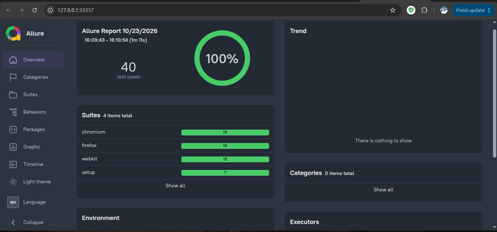

# Enterprise SDET Portfolio: Playwright & TypeScript Hybrid Architecture

An enterprise-grade test automation framework demonstrating senior-level SDET capabilities. Built with Playwright and strict TypeScript, this repository showcases a scalable Page Object Model (POM), dynamic data generation, API contract testing, automated accessibility scanning, and a complete CI/CD pipeline.

## 🚀 Architecture & Tech Stack
* **Core**: Playwright, TypeScript (Strict Mode)
* **Design Pattern**: Fixture-injected Page Object Model (POM)
* **Data Strategy**: Strongly-typed Persona Matrices & `@faker-js/faker` factories
* **Authentication**: Global `storageState` caching for optimal CI execution speed
* **Reporting**: Allure Reports with embedded visual and trace artifacts
* **Resilience**: Network interception & chaos testing (`page.route`)
* **Infrastructure**: Docker containerization & GitHub Actions (Sharded Matrix)

## 📊 Executive Reporting Dashboard


## 🧪 Enterprise Test Suites
1. **Authentication Matrix**: Validates standard, locked-out, and glitch user personas.
2. **E2E Checkout**: Tests cart persistence, Faker-driven dynamic form inputs, and floating-point financial calculations (Subtotal + Tax = Total).
3. **API Contract Validation**: Uses JSON Schema (`ajv`) to strictly enforce backend payload structures directly within the Playwright runner.
4. **Network Chaos Testing**: Simulates CDN outages by aggressively aborting image requests to verify graceful UI degradation.
5. **WCAG 2.1 Accessibility (a11y)**: Automated DOM scanning using `@axe-core/playwright`.

## ⚙️ Local Execution

**Install Dependencies & Browsers**
```bash
npm ci
npx playwright install --with-deps